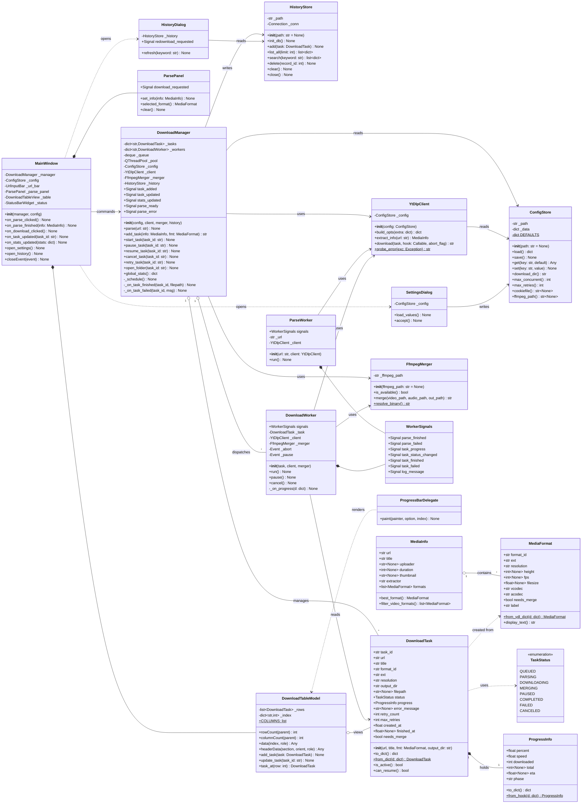
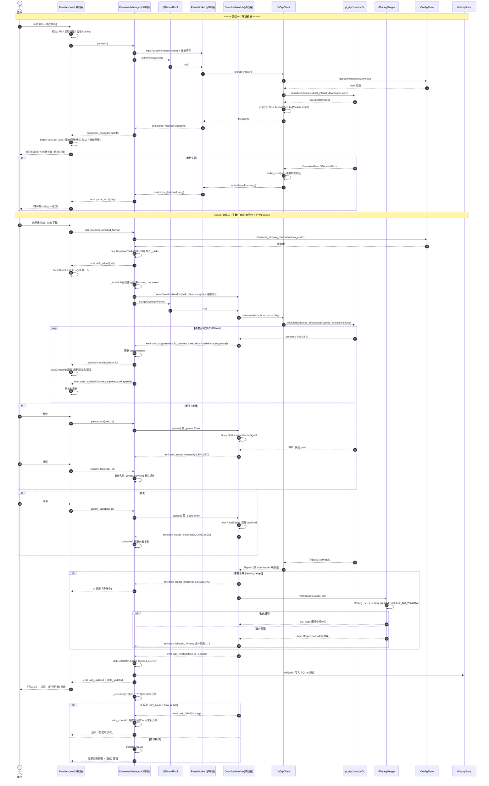
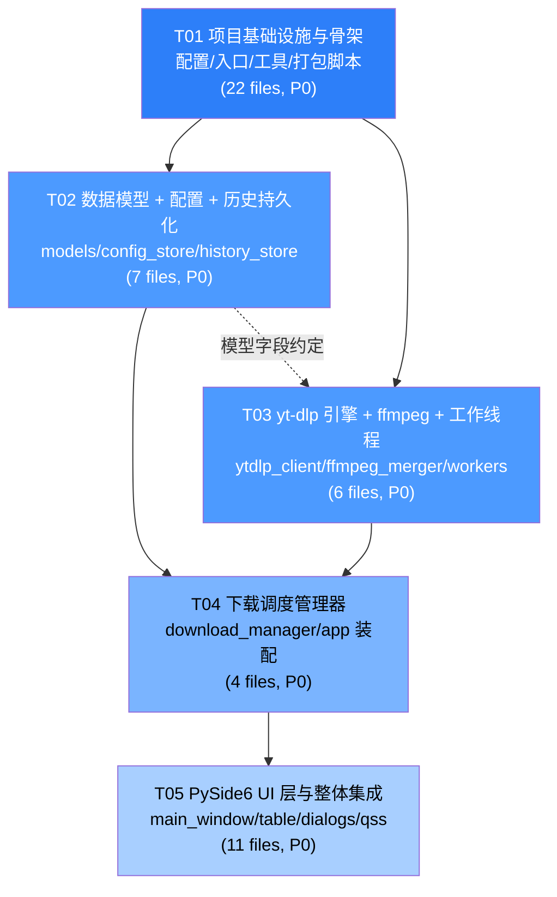

# VidJuice UniTube (Windows 桌面视频下载器) — 系统设计文档

| 项目 | 内容 |
|------|------|
| 文档版本 | v1.0 |
| 架构师 | 高见远（Bob / Architect） |
| 上游输入 | 许清楚（PM）产出的 PRD + 交付总监范围决策 |
| 技术栈 | Python 3.11+ / PySide6 (Qt6) / yt-dlp / ffmpeg / PyInstaller |
| 目标平台 | Windows 10 / 11 (x64) |
| 交付范围 | P0 全部 + P1-1 历史记录 + P1-2 自动合并 + P1-4 错误重试 + 配置持久化 + 打包配置（不执行打包） |
| 明确不做 | 浏览器扩展、付费/DRM 平台、实际 exe 构建产物 |

---

## Part A：系统设计

### 1. 实现方案 + 框架选型

#### 1.1 核心技术难点

| # | 难点 | 解决方案 |
|---|------|----------|
| D1 | yt-dlp 解析/下载是**阻塞 IO + CPU 混合**操作，直接在 UI 线程调用会导致主窗口假死 | 全部放入 `QThreadPool` 的 `QRunnable` 子线程；子线程只通过 **Qt Signal（自动 QueuedConnection）** 与 UI 通信，绝不直接触碰任何 QWidget |
| D2 | yt-dlp **原生不支持 pause/resume/cancel** | 通过 `progress_hooks` 中检查 `threading.Event` 标志位，主动 `raise` 自定义异常中断下载；`.part` 文件保留即为"暂停"，恢复时用 `continuedl=True` 断点续传；取消则额外清理 `.part` / `.ytdl` 临时文件 |
| D3 | 高频进度回调（yt-dlp 可达 10+ 次/秒 × 3 并发）冲垮 Qt 事件循环 | Worker 内做**时间节流**（≥300ms 或百分比变化 ≥1% 才 emit）；Model 层用 `dataChanged(topLeft, bottomRight, [roles])` 精准刷新单行而非 `layoutChanged` |
| D4 | 1080p 以上 YouTube 视频音视频分离（DASH），需 ffmpeg 合并 | 优先让 yt-dlp 内部调用 ffmpeg（`merge_output_format` + `ffmpeg_location`）；同时保留独立 `FfmpegMerger` 作为兜底与显式 MERGING 状态展示 |
| D5 | Windows 下 subprocess 会弹黑框 | 所有 `subprocess` 调用统一加 `creationflags=CREATE_NO_WINDOW` + `startupinfo`（封装在 `utils/proc.py`） |
| D6 | PyInstaller 打包后 ffmpeg 二进制与资源路径失效 | 统一走 `utils/paths.resource_path()`（兼容 `sys._MEIPASS`）；ffmpeg 通过 `binaries` 打进 bundle |
| D7 | Python GIL 下多并发下载的效率 | yt-dlp 下载是 **IO-bound**，GIL 在网络等待时释放，线程池方案足够；不引入 multiprocessing（会大幅增加打包体积与 IPC 复杂度） |
| D8 | 错误信息对用户不友好（英文栈） | `YtDlpClient.probe_error()` 做异常 → 中文可读原因 + 建议的映射表 |

#### 1.2 架构分层与模块划分

采用 **MVVM 变体（Model–View–Manager）** 的三层结构，UI 与业务完全解耦：

```
┌───────────────────────────────────────────────────────────┐
│  UI 层 (src/ui/)  —— 只跑在主线程                          │
│  MainWindow / ParsePanel / DownloadTableView              │
│  SettingsDialog / HistoryDialog / DownloadTableModel      │
└──────────────▲───────────────────────┬────────────────────┘
               │ Signal(task_updated)  │ 方法调用(命令)
┌──────────────┴───────────────────────▼────────────────────┐
│  调度层 (src/core/download_manager.py) —— 主线程对象        │
│  DownloadManager：任务字典 / 等待队列 / 并发闸门 /          │
│  重试策略 / 信号聚合 / 全局统计                             │
└──────────────▲───────────────────────┬────────────────────┘
               │ Signal(progress/done) │ QThreadPool.start()
┌──────────────┴───────────────────────▼────────────────────┐
│  工作线程层 (src/workers/) —— QRunnable 子线程              │
│  ParseWorker / DownloadWorker / WorkerSignals             │
└──────────────▲───────────────────────┬────────────────────┘
               │                       │
┌──────────────┴───────────────────────▼────────────────────┐
│  引擎与持久化层 (src/core/) —— 纯 Python，无 Qt 依赖         │
│  YtDlpClient / FfmpegMerger / ConfigStore / HistoryStore  │
│  models.py (DownloadTask / MediaInfo / MediaFormat)       │
└───────────────────────────────────────────────────────────┘
```

**六大模块职责：**

| 模块 | 位置 | 职责 | 关键约束 |
|------|------|------|----------|
| **解析服务** | `core/ytdlp_client.py` | 封装 `yt_dlp.YoutubeDL`，构建 opts、`extract_info` 解析、格式归一化、异常翻译 | **不 import 任何 PySide6**，保证可单测 |
| **下载调度** | `core/download_manager.py` | 任务生命周期、并发闸门（默认 3）、FIFO 等待队列、指数退避重试、全局统计 | 主线程对象，是 UI 与 Worker 的唯一中介 |
| **工作线程** | `src/workers/` | 承载阻塞调用，通过 `WorkerSignals` 回传 | 严禁触碰 QWidget；Signal 参数只用可序列化基础类型 |
| **配置管理** | `core/config_store.py` | JSON 读写、默认值兜底、原子保存 | 存 `%APPDATA%/VidJuice/config.json` |
| **历史记录** | `core/history_store.py` | SQLite 持久化已完成任务，支持查询/搜索/重下 | 单连接 + `check_same_thread=False` + 锁；只在主线程写 |
| **ffmpeg 合并** | `core/ffmpeg_merger.py` | 定位 ffmpeg 二进制、执行 `-c copy` 合并、错误摘要 | 无窗口 subprocess |
| **Qt 视图** | `src/ui/` | 纯展示 + 用户输入转发 | 不做任何业务判断 |

#### 1.3 线程模型（关键）

```
主线程 (Qt Event Loop)
 ├─ MainWindow / 所有 QWidget / DownloadTableModel
 ├─ DownloadManager（QObject，槽函数在主线程执行 → 修改 task 状态是线程安全的）
 └─ HistoryStore 写入（仅在 DownloadManager 槽内调用）

QThreadPool (maxThreadCount = max_concurrent + 2，为解析预留)
 ├─ ParseWorker    ×1（同一时刻只允许一个解析，UI 层按钮置灰保证）
 └─ DownloadWorker ×N（N ≤ max_concurrent，默认 3）
```

**铁律（写进 Shared Knowledge，工程师必须遵守）：**
1. Worker → UI 的唯一通路是 **Signal**；Signal 跨线程默认 `Qt.AutoConnection` → 实际走 `QueuedConnection`，天然线程安全。
2. UI → Worker 的唯一通路是 **`threading.Event` 标志位**（pause / abort），不用 `terminate()`。
3. `DownloadTask` 对象的**写操作只发生在主线程**（DownloadManager 槽内）；Worker 只读 task 的静态字段（url / format_id / output_dir），进度通过 dict 回传，不直接改 task。
4. Signal 参数**只传 `str` / `int` / `float` / `dict`**，不传自定义可变对象（`MediaInfo` 例外，解析结果只读且一次性）。

#### 1.4 为什么这样分

- **引擎层零 Qt 依赖** → `YtDlpClient` / `ConfigStore` / `HistoryStore` 可用 pytest 直接单测，不需要 QApplication。
- **DownloadManager 作为唯一中介** → UI 不认识 Worker，Worker 不认识 UI；并发策略、重试策略集中一处，未来加"限速""批量导入"只改这一个文件。
- **QThreadPool 而非手工 QThread** → 复用线程、自动排队，代码量少一半，且 `setMaxThreadCount` 直接实现"最大并发数"配置。
- **Model/View + Delegate** → 100 条下载任务高频刷进度也不卡；进度条用 `QStyledItemDelegate` 绘制，比每行塞一个 `QProgressBar` 控件轻量一个数量级。

---

### 2. 文件列表及相对路径

```
VidJuiceUniTube/
├── src/
│   ├── __init__.py                     # 包标记
│   ├── main.py                         # 程序入口：创建 QApplication、组装依赖、显示主窗口
│   ├── app.py                          # 应用装配器（依赖注入）：构建 Config/Client/Merger/History/Manager
│   ├── constants.py                    # 全局常量：APP_NAME、默认目录、配置 key、状态文案映射
│   │
│   ├── core/                           # 业务核心（纯 Python，无 Qt UI 依赖）
│   │   ├── __init__.py
│   │   ├── models.py                   # 数据模型：TaskStatus/MediaFormat/MediaInfo/ProgressInfo/DownloadTask
│   │   ├── config_store.py             # 配置读写：JSON 持久化 + 默认值 + 原子写
│   │   ├── history_store.py            # 历史记录：SQLite 建表/新增/查询/搜索/删除
│   │   ├── ytdlp_client.py             # yt-dlp 封装：opts 构建、extract_info、download、错误翻译
│   │   ├── ffmpeg_merger.py            # ffmpeg 封装：二进制定位、音视频合并、错误摘要
│   │   ├── format_utils.py             # 格式工具：清晰度标签生成、体积/速度/时长格式化、文件名净化
│   │   ├── exceptions.py               # 自定义异常：ParseError/DownloadAbort/DownloadPause/MergeError
│   │   └── download_manager.py         # 调度核心：任务表、并发闸门、队列、重试、统计、信号
│   │
│   ├── workers/                        # Qt 工作线程层
│   │   ├── __init__.py
│   │   ├── signals.py                  # WorkerSignals：统一定义所有跨线程 Signal
│   │   ├── parse_worker.py             # ParseWorker(QRunnable)：子线程执行链接解析
│   │   └── download_worker.py          # DownloadWorker(QRunnable)：子线程执行下载 + 合并 + 中断响应
│   │
│   ├── ui/                             # 视图层（仅主线程）
│   │   ├── __init__.py
│   │   ├── main_window.py              # MainWindow：主窗口布局、菜单、信号连接、全局交互编排
│   │   ├── url_input_bar.py            # UrlInputBar：链接输入框 + [解析]/[下载] 按钮 + 剪贴板自动填充
│   │   ├── parse_panel.py              # ParsePanel：标题/时长展示 + 画质下拉 + 格式下拉 + 缩略图
│   │   ├── download_table.py           # DownloadTableView：下载列表视图 + 右键菜单 + 操作按钮列
│   │   ├── table_model.py              # DownloadTableModel(QAbstractTableModel)：列表数据源
│   │   ├── delegates.py                # ProgressBarDelegate / ActionButtonDelegate：单元格自绘
│   │   ├── status_bar.py               # StatusBarWidget：进行中/已完成/总速度 统计条
│   │   ├── settings_dialog.py          # SettingsDialog：下载目录、并发数、重试次数、ffmpeg 路径
│   │   ├── history_dialog.py           # HistoryDialog：历史列表 + 搜索 + 重新下载 + 打开文件
│   │   └── style.qss                   # 全局 Qt 样式表（配色、圆角、表格斑马线）
│   │
│   ├── utils/
│   │   ├── __init__.py
│   │   ├── paths.py                    # 路径工具：resource_path()、app_data_dir()、默认下载目录、打开资源管理器
│   │   ├── proc.py                     # subprocess 无窗口封装（CREATE_NO_WINDOW）
│   │   └── logger.py                   # 日志：控制台 + 滚动文件（%APPDATA%/VidJuice/logs/app.log）
│   │
│   └── resources/
│       ├── icons/app.ico               # 应用图标（打包用）
│       └── icons/README.md             # 图标资源说明与来源
│
├── tests/
│   ├── __init__.py
│   ├── conftest.py                     # pytest fixtures：临时配置目录、mock yt-dlp
│   ├── test_models.py                  # 数据模型序列化/反序列化测试
│   ├── test_config_store.py            # 配置默认值、持久化、重启保留测试
│   ├── test_history_store.py           # 历史记录 CRUD 与搜索测试
│   ├── test_ytdlp_client.py            # 格式归一化 + 错误翻译测试（mock YoutubeDL）
│   └── test_download_manager.py        # 并发闸门、队列调度、重试逻辑测试（mock Worker）
│
├── build.spec                          # PyInstaller 规格文件（单文件 exe、图标、ffmpeg 二进制、隐藏导入）
├── build.py                            # 构建脚本：清理 dist/build、调用 PyInstaller、产物校验（本版不执行）
├── requirements.txt                    # 运行时依赖
├── requirements-dev.txt                # 开发/测试依赖
├── pytest.ini                          # pytest 配置
├── .gitignore                          # 忽略 dist/build/__pycache__/*.log
├── README.md                           # 项目说明、运行方式、打包方式、已知限制
└── docs/
    ├── system_design.md                # 本文档
    ├── class-diagram.mermaid           # 类图
    └── sequence-diagram.mermaid        # 时序图
```

**文件数统计**：源码 30 个 + 测试 7 个 + 构建/文档 9 个。

---

### 3. 数据结构与接口（类图）



#### 3.1 关键接口签名补充（工程师直接照抄）

```python
# src/core/models.py
class TaskStatus(str, Enum):
    QUEUED = "queued"; PARSING = "parsing"; DOWNLOADING = "downloading"
    MERGING = "merging"; PAUSED = "paused"; COMPLETED = "completed"
    FAILED = "failed"; CANCELED = "canceled"

@dataclass
class ProgressInfo:
    percent: float = 0.0      # 0.0 ~ 100.0
    speed: float = 0.0        # bytes/s
    downloaded: int = 0       # bytes
    total: int | None = None  # bytes, 可能为 None
    eta: float | None = None  # seconds
    phase: str = "downloading"  # downloading | merging

# src/core/ytdlp_client.py
class YtDlpClient:
    def extract_info(self, url: str) -> MediaInfo: ...
    def download(self, task: "DownloadTask",
                 hook: Callable[[dict], None],
                 abort_flag: threading.Event) -> str: ...

# src/core/download_manager.py  (QObject)
class DownloadManager(QObject):
    parse_ready   = Signal(object)        # MediaInfo
    parse_error   = Signal(str)           # 中文错误原因
    task_added    = Signal(object)        # DownloadTask
    task_updated  = Signal(str)           # task_id
    stats_updated = Signal(dict)          # {"active":int,"completed":int,"failed":int,"total_speed":float}

# src/workers/signals.py
class WorkerSignals(QObject):
    parse_finished      = Signal(object)      # MediaInfo
    parse_failed        = Signal(str, str)    # url, message
    task_progress       = Signal(str, dict)   # task_id, progress dict
    task_status_changed = Signal(str, str)    # task_id, TaskStatus.value
    task_finished       = Signal(str, str)    # task_id, filepath
    task_failed         = Signal(str, str)    # task_id, message
    log_message         = Signal(str)         # 日志行
```

---

### 4. 程序调用流程（时序图）



---

### 5. Anything UNCLEAR（待明确事项）

见 Part B 第 10 节。

---

## Part B：任务分解

### 6. 依赖包列表

**`requirements.txt`（运行时）**

```
# ==== 核心引擎 ====
yt-dlp>=2024.12.13          # 视频解析与下载引擎（建议不锁死上限，站点适配靠频繁更新）

# ==== GUI ====
PySide6>=6.6.0,<6.9.0       # Qt6 官方 Python 绑定（LGPL，商用友好）

# ==== 网络与工具 ====
requests>=2.31.0            # 缩略图下载、版本检查
certifi>=2024.2.2           # 打包后 SSL 证书兜底（PyInstaller 必备）

# ==== 可选加速（yt-dlp 推荐）====
brotli>=1.1.0               # 解压 br 编码响应
websockets>=12.0            # 部分站点（如 Bilibili 直播）需要
mutagen>=1.47.0             # 音频元数据写入（yt-dlp 后处理依赖）
pycryptodomex>=3.20.0       # 部分加密流解密（yt-dlp 可选依赖）
```

**`requirements-dev.txt`（开发/测试/打包）**

```
-r requirements.txt
pytest>=8.0.0               # 单元测试
pytest-qt>=4.4.0            # Qt 控件与信号测试
pytest-mock>=3.12.0         # mock yt-dlp 调用
pytest-cov>=5.0.0           # 覆盖率
pyinstaller>=6.5.0          # 打包 exe（本版只出配置，不执行）
ruff>=0.4.0                 # Lint + 格式化
```

**外部二进制（非 pip）**
- `ffmpeg.exe` / `ffprobe.exe`：需放在 `vendor/ffmpeg/bin/` 或系统 PATH；`build.spec` 通过 `binaries` 打入 bundle。README 中说明下载地址（gyan.dev / BtbN 的 Windows build）。

---

### 7. 任务列表（有序，按实现顺序）

> **共 5 个任务**，T01 必须最先完成；T02/T03 可在 T01 完成后并行；T04 依赖 T02+T03；T05 依赖全部。

---

#### **T01｜项目基础设施与骨架**  `P0`

| 项 | 内容 |
|---|---|
| **依赖** | 无 |
| **源文件** | `requirements.txt`、`requirements-dev.txt`、`pytest.ini`、`.gitignore`、`README.md`、`build.spec`、`build.py`、`src/__init__.py`、`src/main.py`、`src/app.py`、`src/constants.py`、`src/utils/__init__.py`、`src/utils/paths.py`、`src/utils/proc.py`、`src/utils/logger.py`、`src/core/__init__.py`、`src/core/exceptions.py`、`src/workers/__init__.py`、`src/ui/__init__.py`、`src/resources/icons/README.md`、`tests/__init__.py`、`tests/conftest.py` |

**要点**
1. `constants.py`：`APP_NAME="VidJuice"`、`ORG_NAME`、`DEFAULT_DOWNLOAD_SUBDIR="Videos/VidJuice"`、`DEFAULT_MAX_CONCURRENT=3`、`DEFAULT_MAX_RETRIES=3`、`PROGRESS_EMIT_INTERVAL=0.3`、全部配置 key 常量、`STATUS_TEXT_MAP`（英文枚举 → 中文文案）。
2. `utils/paths.py`：
   - `resource_path(rel)` 兼容 `sys._MEIPASS`（PyInstaller）与开发态；
   - `app_data_dir()` → `%APPDATA%/VidJuice`（自动创建）；
   - `default_download_dir()` → `%USERPROFILE%/Videos/VidJuice`（自动创建）；
   - `open_in_explorer(path)` → `explorer /select,"path"`；
   - `sanitize_filename(name)` 去除 Windows 非法字符。
3. `utils/proc.py`：`run_hidden(cmd, **kw)` 统一注入 `creationflags=subprocess.CREATE_NO_WINDOW` + `STARTUPINFO`，Windows 下不弹黑框。
4. `utils/logger.py`：`setup_logging()` → 控制台 + `RotatingFileHandler`（5MB × 3）写 `%APPDATA%/VidJuice/logs/app.log`；格式含线程名（便于排查跨线程问题）。
5. `core/exceptions.py`：`AppError` 基类 + `ParseError`、`DownloadError`、`DownloadPause`、`DownloadAbort`、`MergeError`。
6. `app.py`：`build_app()` 依赖装配函数（此阶段可先返回占位/None，T04 后补全），集中管理对象生命周期。
7. `main.py`：`QApplication` 创建 → `setup_logging()` → 高 DPI 策略 → 加载 `style.qss`（文件不存在则跳过）→ 显示 `MainWindow`（此阶段先显示一个空 `QMainWindow` 占位，T05 替换）→ `sys.exit(app.exec())`。
8. `build.spec`：单文件模式；`datas` 含 `src/resources`、`style.qss`；`binaries` 含 `vendor/ffmpeg/bin/ffmpeg.exe`；`hiddenimports` 至少含 `yt_dlp.extractor`（关键，否则打包后解析全挂）、`PySide6.QtSvg`；`icon='src/resources/icons/app.ico'`；`console=False`。
9. `build.py`：清理 `build/`、`dist/` → 调用 `PyInstaller.__main__.run(['build.spec', '--noconfirm'])` → 校验产物存在并打印大小。**本版只提交脚本，不执行。**
10. `README.md`：环境要求（Python 3.11+）、`pip install -r requirements-dev.txt`、`python -m src.main` 运行、`python build.py` 打包、ffmpeg 获取方式、已知限制（不支持 DRM 平台）。
11. **验收**：`python -m src.main` 能弹出一个空白主窗口不报错；`pytest` 能空跑通过。

---

#### **T02｜数据模型 + 配置 + 历史持久化层**  `P0`

| 项 | 内容 |
|---|---|
| **依赖** | T01 |
| **源文件** | `src/core/models.py`、`src/core/config_store.py`、`src/core/history_store.py`、`src/core/format_utils.py`、`tests/test_models.py`、`tests/test_config_store.py`、`tests/test_history_store.py` |

**要点**
1. `models.py`：按第 3 节类图实现 `TaskStatus`(str Enum)、`MediaFormat`、`MediaInfo`、`ProgressInfo`、`DownloadTask`，全部用 `@dataclass`。
   - `DownloadTask.task_id = uuid4().hex[:12]`；
   - `MediaFormat.from_ydl_dict()` 负责从 yt-dlp 原始 dict 提取 `format_id/ext/height/fps/filesize/vcodec/acodec`，并计算 `needs_merge = (acodec == 'none')`；
   - `MediaFormat.label` 生成如 `1080p60 · mp4 · 128.4 MB`；
   - `to_dict()/from_dict()` 支持 JSON 往返（历史记录与未来的任务恢复用）。
2. `format_utils.py`：`human_size(bytes)`、`human_speed(bps)`、`human_eta(sec)`、`resolution_label(h)`（→ 360p/720p/1080p/2K/4K）、`quality_sort_key(fmt)`（用于画质降序排序）。
3. `config_store.py`：
   - `DEFAULTS = {"download_dir": default_download_dir(), "max_concurrent": 3, "max_retries": 3, "default_quality": "best", "default_container": "mp4", "cookiefile": "", "ffmpeg_path": "", "proxy": "", "auto_open_folder": False, "theme": "light", "window_geometry": ""}`
   - 存 `%APPDATA%/VidJuice/config.json`，UTF-8；
   - `load()` 缺 key 用默认值补齐（向前兼容）；损坏 JSON 时备份为 `.bak` 并重建；
   - `save()` 原子写（先写 `.tmp` 再 `os.replace`）；
   - 提供语义化 getter（`download_dir()` / `max_concurrent()` 等），UI 层不直接用裸字符串 key。
4. `history_store.py`：SQLite（`%APPDATA%/VidJuice/history.db`）
   ```sql
   CREATE TABLE IF NOT EXISTS history(
     id INTEGER PRIMARY KEY AUTOINCREMENT,
     task_id TEXT, url TEXT NOT NULL, title TEXT NOT NULL,
     resolution TEXT, ext TEXT, filepath TEXT, filesize INTEGER,
     status TEXT, finished_at REAL);
   CREATE INDEX IF NOT EXISTS idx_title ON history(title);
   ```
   - `search(keyword)` 用 `LIKE '%kw%'` 匹配 title 与 url；
   - 连接用 `check_same_thread=False` + `threading.Lock` 保护；
   - `list_all()` 按 `finished_at DESC` 排序。
5. **验收**：三个测试文件覆盖 —— 默认值生成、写入后重新 load 值保留、损坏文件自愈、history 增删查搜、`DownloadTask` JSON 往返一致。

---

#### **T03｜yt-dlp 引擎 + ffmpeg 合并 + 工作线程层**  `P0`

| 项 | 内容 |
|---|---|
| **依赖** | T01（T02 的 `models.py` 需先就绪，建议 T02 先行或同步约定好数据类字段） |
| **源文件** | `src/core/ytdlp_client.py`、`src/core/ffmpeg_merger.py`、`src/workers/signals.py`、`src/workers/parse_worker.py`、`src/workers/download_worker.py`、`tests/test_ytdlp_client.py` |

**要点**
1. `ytdlp_client.py`
   - `build_opts(extra)` 基础 opts：
     ```python
     {"quiet": True, "no_warnings": True, "noprogress": True,
      "socket_timeout": 30, "retries": 3, "nocheckcertificate": False,
      "ignoreerrors": False, "noplaylist": True,
      "ffmpeg_location": <config.ffmpeg_path or resolved>,
      "cookiefile": <config.cookiefile or None>,   # 空字符串必须转 None
      "proxy": <config.proxy or None>}
     ```
   - `extract_info(url)`：`download=False`；若返回含 `entries`（播放列表）取第一条并记 warning；调用 `MediaFormat.from_ydl_dict` 归一化，过滤掉 `vcodec=='none' and acodec=='none'` 的无效项；按 `quality_sort_key` 降序；插入一个伪格式 `format_id="bestvideo+bestaudio/best"`，label="最佳画质（自动）"，`needs_merge=True` 置顶作为默认项。
   - `download(task, hook, abort_flag)`：opts 追加
     ```python
     {"format": task.format_id,
      "outtmpl": os.path.join(task.output_dir, "%(title).150B [%(id)s].%(ext)s"),
      "merge_output_format": task.ext if task.ext in ("mp4","mkv","webm") else "mp4",
      "progress_hooks": [hook],
      "continuedl": True,          # 断点续传，暂停/恢复关键
      "windowsfilenames": True,
      "restrictfilenames": False}
     ```
     用 `ydl.extract_info(url, download=True)` 拿返回 dict，通过 `ydl.prepare_filename(info)` + `requested_downloads` 推断最终路径并返回。
   - `probe_error(exc)` 静态方法：错误关键字 → 中文映射表，至少覆盖
     | 关键字 | 中文提示 |
     |---|---|
     | `Unsupported URL` | 暂不支持该网站，请确认链接是否正确 |
     | `Video unavailable` / `Private video` | 视频不存在、已删除或为私享视频 |
     | `Sign in to confirm your age` | 该视频有年龄限制，需要在设置中配置 cookie 文件 |
     | `DRM` / `protected` | 该平台使用 DRM 加密保护，本软件不支持下载 |
     | `HTTP Error 429` | 请求过于频繁，请稍后再试或配置代理 |
     | `timed out` / `Connection` | 网络连接超时，请检查网络或代理设置 |
     | `No space left` | 磁盘空间不足 |
     | 兜底 | 解析失败：{原始信息前 200 字} |
2. `ffmpeg_merger.py`
   - `resolve_binary()`：优先 config 指定 → `resource_path("vendor/ffmpeg/bin/ffmpeg.exe")` → `shutil.which("ffmpeg")` → 抛 `MergeError`。
   - `merge(v, a, out)`：`ffmpeg -y -i v -i a -c:v copy -c:a copy -movflags +faststart out`，用 `utils.proc.run_hidden` 执行，超时 600s；失败取 `stderr` 最后 5 行作为摘要抛 `MergeError`。
3. `signals.py`：按第 3.1 节签名定义 `WorkerSignals(QObject)`。**所有 Signal 集中此处定义，禁止在各 Worker 内散落定义。**
4. `parse_worker.py`：`ParseWorker(QRunnable)`，`run()` 内 try/except 全包裹（子线程异常逃逸会静默崩溃），成功 `emit parse_finished(info)`，失败 `emit parse_failed(url, YtDlpClient.probe_error(e))`。
5. `download_worker.py`：`DownloadWorker(QRunnable)`
   - 持有 `_abort = threading.Event()`、`_pause = threading.Event()`；
   - `_on_progress(d)`：
     ```python
     if self._abort.is_set(): raise DownloadAbort()
     if self._pause.is_set(): raise DownloadPause()
     now = time.monotonic()
     if now - self._last_emit < 0.3 and d.get("status") != "finished": return
     self._last_emit = now
     self.signals.task_progress.emit(self._task.task_id, ProgressInfo.from_hook(d).to_dict())
     ```
   - `run()` 分支：正常完成 → 若 `needs_merge` 且 yt-dlp 未自动合并则调 `FfmpegMerger`（先 emit MERGING 状态）→ `task_finished`；`DownloadPause` → `task_status_changed(PAUSED)`；`DownloadAbort` → 清理 `.part`/`.ytdl` → `task_status_changed(CANCELED)`；其他异常 → `task_failed(id, probe_error(e))`。
   - `setAutoDelete(False)`，由 DownloadManager 管理引用，避免暂停后对象被回收。
6. **验收**：`test_ytdlp_client.py` 用 mock 的 YoutubeDL 覆盖格式归一化排序、伪"最佳画质"插入、错误映射表全部分支。

---

#### **T04｜下载调度管理器（DownloadManager）**  `P0`

| 项 | 内容 |
|---|---|
| **依赖** | T02、T03 |
| **源文件** | `src/core/download_manager.py`、`src/app.py`（补全依赖装配）、`tests/test_download_manager.py`、`tests/conftest.py`（补充 fixtures） |

**要点**
1. `DownloadManager(QObject)` 持有 `_tasks: dict[str, DownloadTask]`、`_workers: dict[str, DownloadWorker]`、`_queue: deque[str]`、`_pool = QThreadPool()`（`setMaxThreadCount(max_concurrent + 2)`）。
2. `parse(url)`：创建 `ParseWorker`，连接 `parse_finished → parse_ready` 转发、`parse_failed → parse_error` 转发，`_pool.start()`。同一时刻仅允许一个解析（内部 `_parsing` 布尔位 + UI 按钮置灰双保险）。
3. `add_task(info, fmt)`：构造 `DownloadTask`（output_dir 取 `config.download_dir()`，`max_retries` 取 config），存表 → `emit task_added(task)` → `_schedule()`，返回 `task_id`。
4. `_schedule()`（**并发闸门核心**）：
   ```
   running = count(status in {DOWNLOADING, MERGING})
   while running < config.max_concurrent() and _queue:
       tid = _queue.popleft()
       若 task 仍为 QUEUED 则 _launch(tid); running += 1
   ```
   在 **任务完成 / 失败 / 取消 / 暂停 / 新增 / 修改并发配置** 后都要调用。
5. `pause_task` / `resume_task` / `cancel_task` / `retry_task`：
   - pause → `worker.pause()`（若还在队列中未启动，直接置 PAUSED 并移出队列）；
   - resume → 状态置 QUEUED，`_queue.append`，`_schedule()`；
   - cancel → `worker.cancel()`；未启动的直接置 CANCELED；
   - retry → `retry_count = 0`、清空 `error_message`、重新入队。
6. **自动重试（P1-4）**：`_on_task_failed` 中若 `retry_count < max_retries` 且错误非"不可重试类"（DRM/不支持的 URL/视频不存在 → 直接 FAILED，不浪费时间重试），则 `retry_count += 1`，用 `QTimer.singleShot(2**retry_count * 1000, lambda: 重新入队)` 做指数退避；否则置 FAILED。UI 显示"重试中 (n/N)"。
7. `_on_task_finished`：置 COMPLETED、记 `finished_at`、写 `HistoryStore.add(task)`、`emit task_updated` + `stats_updated`、若 `config.auto_open_folder` 则打开目录、`_schedule()`。
8. `global_stats()` → `{"active": n, "queued": n, "completed": n, "failed": n, "total_speed": sum(speed of DOWNLOADING)}`；用一个 1s 的 `QTimer` 定时 emit `stats_updated`，避免每个进度包都重算全局。
9. `shutdown()`：窗口关闭时调用 —— 给所有活跃 worker 置 abort、`_pool.waitForDone(3000)`、`history.close()`、`config.save()`。
10. `app.py` 补全：
    ```python
    def build_app():
        config = ConfigStore(); config.load()
        history = HistoryStore(); history.init_db()
        client = YtDlpClient(config)
        merger = FfmpegMerger(config.ffmpeg_path() or None)
        manager = DownloadManager(config, client, merger, history)
        return config, manager
    ```
11. **验收**：`test_download_manager.py` 用 mock Worker（不真下载）验证：并发上限严格不超过 3、完成后自动拉起队列下一个、失败重试次数正确、不可重试错误不重试、取消释放名额。

---

#### **T05｜PySide6 UI 层与整体集成**  `P0`

| 项 | 内容 |
|---|---|
| **依赖** | T01、T02、T03、T04 |
| **源文件** | `src/ui/main_window.py`、`src/ui/url_input_bar.py`、`src/ui/parse_panel.py`、`src/ui/table_model.py`、`src/ui/download_table.py`、`src/ui/delegates.py`、`src/ui/status_bar.py`、`src/ui/settings_dialog.py`、`src/ui/history_dialog.py`、`src/ui/style.qss`、`src/main.py`（接入真实 MainWindow） |

**要点**
1. **布局**严格对齐 PRD 线框（`QVBoxLayout` 四段）：
   - 顶部 `UrlInputBar`：`QLineEdit`（placeholder"粘贴视频地址…"）+ `[解析]` + `[下载]`；支持 `Ctrl+V` 后自动识别、启动时若剪贴板是 URL 则自动填入；回车 = 解析。
   - 第二段 `ParsePanel`：标题 + up 主 + 时长 + 缩略图（异步加载，失败留空）+ 画质 `QComboBox`（默认选中"最佳画质（自动）"）+ 容器 `QComboBox`（mp4/webm）；解析前整体 `setVisible(False)`。
   - 第三段 `DownloadTableView`（占主要空间，stretch=1）。
   - 底部 `StatusBarWidget`：`进行中 N | 已完成 N | 失败 N | 总速度 X MB/s`。
2. `table_model.py`：`DownloadTableModel(QAbstractTableModel)`，列 = `["文件名","画质","进度","速度","状态","操作"]`。
   - `_index: dict[task_id → row]` 保证 `update_task` 是 O(1)；
   - `update_task` 只 emit 该行 `dataChanged`，**禁止用 `layoutChanged`/`beginResetModel`**（会导致选中态丢失 + 卡顿）；
   - 自定义 role：`ROLE_TASK = Qt.UserRole + 1`（返回 DownloadTask 对象供 Delegate 用）。
3. `delegates.py`：
   - `ProgressBarDelegate.paint()` 用 `QStyleOptionProgressBar` + `QApplication.style().drawControl` 绘制；MERGING 状态显示"合并中…"忙碌样式；FAILED 显示红色文字。
   - `ActionButtonDelegate`：根据状态动态渲染按钮组 —— DOWNLOADING→[暂停][取消]；PAUSED→[继续][取消]；FAILED→[重试][移除]；COMPLETED→[打开目录][移除]；QUEUED→[取消]。用 `editorEvent` 捕获点击并 emit 自定义信号给 View 转发。
4. `main_window.py`（**集成中枢**）：
   - 构造时接收 `manager` 与 `config`，连接全部信号：
     `manager.parse_ready → on_parse_finished`、`parse_error → 弹 QMessageBox`、`task_added → model.add_task`、`task_updated → model.update_task`、`stats_updated → status_bar.update_stats`；
   - 菜单栏：设置（`Ctrl+,`）、历史记录（`Ctrl+H`）、打开下载目录、关于；
   - `closeEvent`：若有活跃任务弹确认框；确认后 `manager.shutdown()`、保存窗口几何到 config。
   - 完成提示：状态栏文案 + `QSystemTrayIcon.showMessage()`（托盘图标可用时）。
5. `settings_dialog.py`：下载目录（`QLineEdit` + [浏览] `QFileDialog.getExistingDirectory`）、最大并发（`QSpinBox` 1–10）、失败重试次数（`QSpinBox` 0–10）、ffmpeg 路径（可选）、cookie 文件（可选，注明"用于需登录的站点"）、代理（可选）、完成后自动打开目录（`QCheckBox`）。`accept()` 写回 `ConfigStore.save()`，并同步 `manager` 的并发上限（改完立即生效，调用 `_schedule()`）。
6. `history_dialog.py`：`QTableWidget` 展示 标题/画质/大小/完成时间/路径；顶部搜索框实时过滤；右键/按钮支持 [打开文件][打开目录][重新下载][删除记录][清空]；[重新下载] emit `redownload_requested(url)` → MainWindow 填入输入框并自动触发解析。
7. `style.qss`：浅色主题，主色 `#2D7FF9`，表格斑马纹、圆角 6px、按钮 hover/pressed 态、进度条渐变。
8. `main.py` 收尾：`config, manager = build_app()` → `MainWindow(manager, config)` → 恢复窗口几何 → `show()`。
9. **验收（端到端）**：粘贴一个 YouTube/Bilibili 链接 → 解析出画质列表 → 选 1080p → 下载 → 进度条与速度实时刷新 → 暂停/继续/取消可用 → 完成后自动合并为单一 mp4 → 状态栏统计正确 → 打开目录能定位文件 → 重启应用后设置与历史记录仍在。

---

### 8. 共享知识（跨文件约定）

> **工程师必须严格遵守以下约定，否则跨模块会对不上。**

#### 8.1 信号命名与签名（唯一真源：`src/workers/signals.py` + `DownloadManager`）

| 信号 | 定义位置 | 签名 | 发出方 → 接收方 |
|---|---|---|---|
| `parse_finished` | WorkerSignals | `(object)` MediaInfo | ParseWorker → DownloadManager |
| `parse_failed` | WorkerSignals | `(str, str)` url, 中文msg | ParseWorker → DownloadManager |
| `task_progress` | WorkerSignals | `(str, dict)` task_id, progress | DownloadWorker → DownloadManager |
| `task_status_changed` | WorkerSignals | `(str, str)` task_id, status.value | DownloadWorker → DownloadManager |
| `task_finished` | WorkerSignals | `(str, str)` task_id, filepath | DownloadWorker → DownloadManager |
| `task_failed` | WorkerSignals | `(str, str)` task_id, 中文msg | DownloadWorker → DownloadManager |
| `parse_ready` | DownloadManager | `(object)` MediaInfo | Manager → MainWindow |
| `parse_error` | DownloadManager | `(str)` 中文msg | Manager → MainWindow |
| `task_added` | DownloadManager | `(object)` DownloadTask | Manager → MainWindow |
| `task_updated` | DownloadManager | `(str)` task_id | Manager → MainWindow |
| `stats_updated` | DownloadManager | `(dict)` 统计 | Manager → StatusBar |

**命名规则**：`名词_过去分词`（`task_finished`）表示事件已发生；UI 槽函数统一 `on_<signal_name>`。

#### 8.2 进度数据格式（`ProgressInfo.to_dict()`，全链路唯一格式）

```python
{
    "percent":    45.6,        # float, 0.0~100.0；total 未知时用 downloaded/total_estimate，再不行给 -1
    "speed":      1258291.0,   # float, bytes/s；未知给 0.0
    "downloaded": 52428800,    # int, bytes
    "total":      114857600,   # int|None, bytes
    "eta":        49.0,        # float|None, seconds
    "phase":      "downloading"  # "downloading" | "merging"
}
```
- 来源映射：`downloaded_bytes` → `downloaded`；`total_bytes` 或 `total_bytes_estimate` → `total`；`speed` → `speed`；`eta` → `eta`。
- **UI 侧格式化统一走 `format_utils.human_*()`，禁止各处自己写 `/1024/1024`。**

#### 8.3 配置文件约定

- 路径：`%APPDATA%/VidJuice/config.json`（`utils.paths.app_data_dir()`）
- key 全部在 `constants.py` 定义为常量（如 `CFG_DOWNLOAD_DIR = "download_dir"`），禁止硬编码字符串。

| key | 类型 | 默认值 | 说明 |
|---|---|---|---|
| `download_dir` | str | `%USERPROFILE%/Videos/VidJuice` | 默认下载目录 |
| `max_concurrent` | int | `3` | 最大并发下载数 |
| `max_retries` | int | `3` | 失败自动重试次数 |
| `default_quality` | str | `"best"` | 默认画质选项 |
| `default_container` | str | `"mp4"` | 默认容器格式 |
| `cookiefile` | str | `""` | yt-dlp cookie 文件路径（空=不用） |
| `ffmpeg_path` | str | `""` | ffmpeg 可执行文件路径（空=自动查找） |
| `proxy` | str | `""` | 代理地址（空=直连） |
| `auto_open_folder` | bool | `false` | 完成后自动打开目录 |
| `theme` | str | `"light"` | 主题（本版仅 light） |
| `window_geometry` | str | `""` | 窗口几何（base64） |

#### 8.4 yt-dlp 封装方式

- **只允许通过 `YtDlpClient` 访问 yt-dlp**，其他任何文件禁止 `import yt_dlp`（便于统一 opts、错误翻译与未来替换引擎）。
- 使用 **库方式**（`yt_dlp.YoutubeDL`）而非 subprocess：进度可通过 `progress_hooks` 结构化回传，无需解析 stdout 文本；打包体积更小。
- opts 构建走 `build_opts(extra: dict)`，基础 opts 与任务级 opts 分离；**空字符串配置项必须转成 `None`**（yt-dlp 对 `cookiefile=""` 会报错）。
- 每次调用创建**新的** `YoutubeDL` 实例（with 上下文），不复用（内部有状态，并发复用会串数据）。

#### 8.5 其他约定

- **状态文案**：`TaskStatus` 存英文枚举值，UI 显示走 `constants.STATUS_TEXT_MAP`（排队中/下载中/合并中/已暂停/已完成/失败/已取消）。
- **异常边界**：所有 `QRunnable.run()` 必须整体 try/except；子线程未捕获异常不会进 Qt 的异常处理，会静默吞掉。
- **日志**：`logging.getLogger(__name__)`，禁止 `print`。
- **时间**：内部一律 `time.time()`（Unix 时间戳 float），显示时才转本地时间字符串。
- **文件命名模板**：`%(title).150B [%(id)s].%(ext)s` + `windowsfilenames=True`，避免 Windows 260 字符路径与非法字符问题。
- **中文注释与中文 UI 文案**；代码标识符用英文。
- **禁止**在 `src/core/` 下 import 任何 `PySide6.QtWidgets`（`download_manager.py` 例外，仅允许 `QtCore`）。

---

### 9. 任务依赖图



**并行建议**：T01 完成后，T02 与 T03 可由两人并行（T03 只依赖 T02 的数据类字段定义，可先约定接口再并行）。单人开发按 T01→T02→T03→T04→T05 顺序即可。

---

### 10. 待明确事项（Anything UNCLEAR）

| # | 事项 | 当前设计假设 | 需确认方 |
|---|---|---|---|
| Q1 | **ffmpeg 二进制的分发方式**：随 exe 打包（+~80MB 体积）还是首次运行时引导用户下载？ | 当前假设：`vendor/ffmpeg/bin/` 随包分发，`build.spec` 已按此写；同时支持配置项手动指定 | 产品/交付总监 |
| Q2 | **播放列表（playlist）链接**的处理 | 当前 `noplaylist=True`，只取第一条视频并给出提示。批量下载列表留待迭代 | 产品 |
| Q3 | **暂停后应用退出，未完成任务是否需要恢复** | 当前不做任务队列持久化（重启后未完成任务丢失，`.part` 文件保留但不自动恢复）。若需要，追加 `tasks.json` 持久化，属迭代项 | 产品 |
| Q4 | **Bilibili 大会员 / 需登录内容** | 架构已预留 `cookiefile` 配置项（设置页可填），但不做浏览器 cookie 自动导入（`cookiesfrombrowser` 在打包环境下可靠性差） | 产品 |
| Q5 | **完成提示形态**：系统托盘气泡 vs 应用内提示 vs 声音 | 当前实现托盘气泡 + 状态栏文案，无声音 | 设计 |
| Q6 | **测试覆盖率目标** | 当前设计仅对 `core/` 纯逻辑层做单测（目标 ≥70%），UI 层不做自动化测试（靠手工验收清单） | 交付总监 |
| Q7 | **yt-dlp 自动更新机制** | 本版不做（站点失效需用户升级软件）。建议迭代加"检查更新"入口 | 产品 |
| Q8 | **多语言 / 深色主题** | 本版仅中文 + 浅色。`style.qss` 已单文件隔离，加深色主题成本低 | 产品 |
| Q9 | **单实例限制** | 当前未做互斥锁（可开多个实例，可能导致配置文件写冲突）。建议 T01 追加 `QLocalServer` 单实例检测，成本约 20 行 | 交付总监 |

---

**文档结束** — 本文档可直接作为工程师（寇豆码）的实现蓝图，按 T01→T05 顺序实施。
